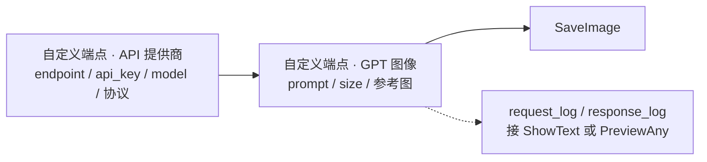
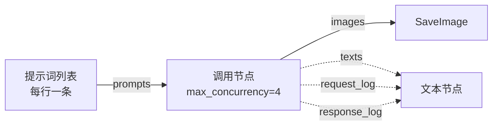
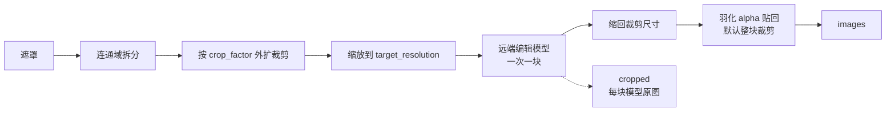

# ComfyUI-Custom-Endpoint-Nodes

**用你自己的 API 端点，在 ComfyUI 里跑 GPT / Gemini / Grok / Qwen 的图像与文本模型。**
官方接口、中转站、私有代理都行；端点、密钥、模型只填一次，图像、文本、局部重绘共用。

[](LICENSE)


> ComfyUI 原生的「合作伙伴节点」把端点写死，并且只走 ComfyUI 官方代理——你没法让它去打自己的
> 中转站。本包把**端点、密钥、模型**抽成一个独立的**提供商节点**，调用节点只管参数与执行；
> 另外补上了官方节点没有的并发批次、双路日志、批量拼接、远端局部重绘，以及三层密钥保护。

---

## 目录

- [特性](#特性)
- [节点一览](#节点一览)
- [安装](#安装)
- [快速开始](#快速开始)
- [功能详解](#功能详解)
  - [批次与并发](#批次与并发)
  - [「不发送」哨兵](#不发送哨兵)
  - [图像批量拼接：两种批次](#图像批量拼接两种批次)
  - [API 局部重绘](#api-局部重绘)
  - [密钥与元数据](#密钥与元数据)
  - [日志](#日志)
- [常见问题](#常见问题)
- [已知限制](#已知限制)
- [开发与测试](#开发与测试)
- [许可](#许可)

---

## 特性

| 能力 | 说明 |
|---|---|
| **端点自由** | 官方接口、one-api / new-api / LiteLLM 之类的中转、自建代理都能接；只填 base URL，其余自动拼。 |
| **提供商独立成节点** | 端点 / 密钥 / 模型 / 协议 / 超时 / 重试 / 额外请求头填一处，多个调用节点复用。 |
| **协议可显式指定** | `auto` 按模型名推断（Qwen 还会看端点主机区分官方与中转线路），猜错了手动选。 |
| **并发批次** | 输入是列表（例如提示词按行切分）时并发调用，`max_concurrency` 1–16，输出顺序与输入一致。 |
| **两路日志** | `request_log` 是实际发出的请求（图片变成尺寸摘要、凭据打码），`response_log` 是服务商返回（状态码 / 耗时 / 正文 / 解析结果）。 |
| **失败不炸队列** | 任何一项失败都返回 **1×1 图片 + 报错信息**，队列继续跑，其它项不受影响。 |
| **参数面贴近原生** | `size / quality / background / aspect_ratio / resolution / thinking_level / n / seed …` 与官方合作伙伴节点对齐；模型专属字段用「不发送」缺省，避免严格中转因未知字段 400。 |
| **零第三方依赖** | 只用标准库 + ComfyUI 自带的 torch / numpy / Pillow，不会碰你的 CUDA torch。 |

## 节点一览

共 14 个节点：1 个提供商、9 个调用节点、2 个文件加载、2 个工具节点。

| 节点 | 类别 | 协议 | 输出 | 说明 |
|---|---|---|---|---|
| 自定义端点 · API 提供商 | 提供商 | — | `provider` | 端点 / 密钥 / 模型 / 协议 / 加密导出 / 超时 / 重试 / 额外请求头 / 显示名 |
| 自定义端点 · GPT 图像 | 图像 | `openai_images` | 4 路 | `gpt-image-2.5-flare`、`gpt-image-2`、`gpt-image-1.5`…；连参考图即走 `/images/edits`，支持原生 `mask` |
| 自定义端点 · Gemini 图像 | 图像 | `gemini` | 5 路 | Nano Banana 2，`gemini-3.1-flash-image` / `-lite`；多一路 `thought_images`（思维图） |
| 自定义端点 · Grok 图像 | 图像 | `grok` | 4 路 | `grok-imagine-image-2.0` / `-quality` / `-pro` / `-image` |
| 自定义端点 · Qwen 图像 | 图像 | `qwen` / `qwen_images` | 4 路 | `qwen-image-3.0-pro` / `qwen-image-3.0`；`width×height`、`n`、`seed`、`prompt_extend`、`watermark` |
| 自定义端点 · Qwen 图像编辑 | 图像 | `qwen` / `qwen_images` | 4 路 | 1–3 张参考图 + 提示词，支持 `@Image1` 引用；`size_mode` = `match input` / `auto` / `custom` |
| 自定义端点 · API 局部重绘 | 局部重绘 | 上述图像协议 | 5 路 | 对标 Impact Pack 的 `MaskDetailer`：遮罩 → 连通域 → 外扩裁剪 → 远端编辑 → 羽化贴回，附 `cropped` 调试输出 |
| 自定义端点 · GPT 对话 | 文本 | `openai_chat` / `openai_responses` | 3 路 | `/chat/completions`（默认，中转友好）或 `/responses`，可附图和文件 |
| 自定义端点 · Gemini 对话 | 文本 | `gemini` | 3 路 | `generateContent`，系统指令、thinking level、采样参数、图片与文件 |
| 自定义端点 · Grok 对话 | 文本 | `grok` | 3 路 | 按 xAI 兼容的 `/chat/completions` 实现 |
| 自定义端点 · GPT 文件加载 | 文件 | — | `files` | `.txt` / `.pdf`，可链式串联 |
| 自定义端点 · Gemini 文件加载 | 文件 | — | `files` | `.txt` / `.pdf` → `inlineData` |
| 自定义端点 · 图像批量拼接 | 工具 | — | `images` + `image_list` | 多张 IMAGE 合并：`images` 是统一画布的张量批次（默认等比留边、不畸变），`image_list` 是原尺寸 list |
| 自定义端点 · 提示词列表 | 工具 | — | `prompts` | 每行一条提示词，输出列表以触发并发批次 |

所有调用节点都有 `request_log` / `response_log` 两路文本输出；`max_concurrency` 默认 4。

### 协议与线路

| 协议 | 实际请求 | 典型端点 |
|---|---|---|
| `auto` | 按模型名推断；Qwen 再看主机名 | — |
| `openai_images` | `POST /images/generations`、`/images/edits` | `https://api.openai.com/v1` 或中转 |
| `openai_chat` | `POST /chat/completions` | 官方或中转 |
| `openai_responses` | `POST /responses` | 官方或中转 |
| `gemini` | `POST /models/{model}:generateContent` | `https://generativelanguage.googleapis.com/v1beta` 或中转 |
| `grok` | `POST /images/generations`、`/chat/completions`（xAI 兼容形状） | `https://api.x.ai/v1` 或中转 |
| `qwen` | DashScope 原生 `POST /services/aigc/multimodal-generation/generation` | `https://dashscope.aliyuncs.com/api` |
| `qwen_images` | OpenAI 兼容 `POST /images/edits`、`/images/generations` | 中转站几乎只开这条 |

`auto` 的推断顺序：`gpt-image` / `dall-e` → `grok` → `gemini` → `qwen-image`，都不匹配就回落到
`openai_chat`。**模型专属节点只接受自己的协议**，所以把「Gemini 图像」接到 `openai_chat` 上会得到
明确的 `protocol_mismatch`，而不是一句看不懂的 400。

> **Qwen 有两条线路，由 `api_protocol` 决定**
> - `qwen`：DashScope 原生接口，官方端点用这个，面积上限 2560×2560。
> - `qwen_images`：中转几乎只暴露的 OpenAI 兼容形状，`image` 直接放 data URL（1 张放字符串，
>   2–3 张放数组），上游实测面积上限 2048×2048。
> - 用 `auto` 时按端点主机判断：`*aliyuncs.com` / `*dashscope*` 走原生，其余走 `qwen_images`。
> - 把 `qwen` 接到只开 OpenAI 路由的中转上时，节点会在收到 `404 Invalid URL` 后**自动改走
>   `/images/edits` 重试一次**，并在 `request_log.extra.fallback` 里记下这次切换——不会静默换线。

## 安装

### 手动安装

```bash
cd ComfyUI/custom_nodes
git clone https://github.com/let-the-name-be-x1/ComfyUI-Custom-Endpoint-Nodes.git
```

或下载 zip 解压到 `ComfyUI/custom_nodes/ComfyUI-Custom-Endpoint-Nodes`（保证 `__init__.py` 在
该目录根上）。重启 ComfyUI，新建节点菜单里会多出 **自定义端点 API**（工具节点在
「自定义端点 API · 附属」）分类。

### 更新

```bash
cd ComfyUI/custom_nodes/ComfyUI-Custom-Endpoint-Nodes
git pull
```

### 环境要求

| 项 | 要求 |
|---|---|
| ComfyUI | 支持 `WEB_DIRECTORY` 前端扩展的版本（近一年的官方版、桌面版、aki 整合包均可） |
| Python | ≥ 3.10（ComfyUI 自带的环境就够） |
| 第三方依赖 | **无**。`pyproject.toml` 的 `dependencies` 故意留空——声明 torch/numpy 会让 ComfyUI Manager 尝试 pip 安装，可能把用户的 CUDA torch 换成 CPU 版 |
| 浏览器 | 无特殊要求，前端扩展只做密码框、导出抹除和端口显隐 |

### ComfyUI Manager

等注册进 Comfy Registry 后，可以在 Manager 里搜 **Custom Endpoint** 安装；在那之前请用上面的
`git clone`。本包不改 ComfyUI 本体，删掉目录即卸载。

## 快速开始



1. 新建 **自定义端点 · API 提供商**，四个必填项：
   - `endpoint`：例如 `https://api.example.com/v1`。不写版本号时自动补 `/v1`，`gemini` 协议补 `/v1beta`。
   - `api_key`：你的密钥。节点上是密码框，点「编辑」填写；留空则不发送鉴权头。
   - `model`：原样传给服务商的模型 id，例如 `gpt-image-2.5-flare` / `gemini-3.1-flash-image` /
     `grok-imagine-image-2.0` / `qwen-image-3.0`；也可以直接填原生节点上显示的模型名，会自动映射。
   - `api_protocol`：不确定就 `auto`；猜错时调用节点的 `response_log` 会说明该选哪个。

2. 接一个调用节点，把 `provider` 连上，填提示词。
3. `images` → `SaveImage`；`request_log` / `response_log` → 任意文本预览节点（如 `ShowText`、`PreviewAny`）。

### 示例工作流

`example_workflows/` 里是三份**真实在用的工作流**，直接拖进 ComfyUI 即可：

| 文件 | 演示什么 | 用到的第三方节点 |
|---|---|---|
| `基础示例工作流（GPT）.json` | 提供商 + GPT 图像 + 两张参考图；`request_log` / `response_log` 落盘并预览 | `StringConcatenate`、pysssss 的 `SaveText` / `ShowText` |
| `批量API绘图（gemini-GPT二采）.json` | 提示词批量切分 → 并发调用；GPT 一采 + Gemini 二采；`Image Comparer` 对比结果 | `CR Split String` / `CR String To Combo`、`easy promptLine`、pysssss、rgthree、ComfyMath |
| `gemini局部修复.json` | `SAM3_Detect` 自动出遮罩 → API 局部重绘（Gemini）→ 回存；每块原图走 `cropped` 输出 | SAM3 检测节点、pysssss |

> 这三份工作流是作者日常实际使用的图，所以带了不少辅助节点。缺哪个包，对应节点在 ComfyUI 里
> 会标红，但**删掉它们不影响本包节点的用法**——最小可用图就是上面那张三节点流程图。
> 示例里的 `endpoint` 和 `api_key` 都是空的，首次打开请自己填。

## 功能详解

### 批次与并发

调用节点声明了 `INPUT_IS_LIST`：所有输入按「长度 1 广播、长度 N 对齐」处理。`max_concurrency`
决定线程数（1–16，默认 4）。



- 输出列表与输入列表**顺序一致**。
- 某一项失败只影响它自己：那一项是 1×1 图片 + 报错串，其余照常。
- 对齐失败（例如提示词 3 条、参考图 2 张）会在派发**之前**报错——整条 prompt 失败，而不是
  某一项失败。这是有意的取舍：配对比配错好。

### 「不发送」哨兵

调用节点在 `INPUT_TYPES()` 时不知道该提供商最终用哪个模型，所以只能展示**该家族参数的超集**。
没用的字段必须能被显式省略，否则严格的中转会因未知字段直接 400。于是：

| 类型 | 省略值 |
|---|---|
| 组合框 | 首项 `不发送` |
| 整数 / 浮点 | `-1` |
| 字符串 | 空串 |
| 布尔 | 无哨兵，`false` 是有效值 |

命中哨兵的字段**根本不会出现在请求体里**。所以看到 `quality = 不发送` 就是「不传这个参数」，
不等于「传 low」。

### 图像批量拼接：两种批次

ComfyUI 里「一批图」有两种容器，**能不能混尺寸完全不同**：

| 容器 | 形态 | 混尺寸 | 下游行为 |
|---|---|---|---|
| 张量批次 | 一个 `[N,H,W,3]` 张量 | ✘ 所有帧共享 H/W | 整个张量交给节点，节点自己按帧循环 |
| list | 每项一个独立张量 | ✔ 每项各是各的尺寸 | 普通节点**按项被调用**；`INPUT_IS_LIST` 节点收到整表 |

所以「图像批量拼接」同时给两路输出（输入是 `image_1`…`image_4`，最多 4 张）：

- **`images`（张量批次）**：一次 API 请求要带多张参考图时用它。张量批次只能有一个画布，
  尺寸不同时会先统一：

  | 参数 | 取值 | 说明 |
  |---|---|---|
  | `size_mode` | `max size`（默认）/ `first image` / `manual` | 画布来源：各图最大宽×最大高 / 第一张 / 手动 `width`×`height`（0 = 该边自动） |
  | `fit` | `contain`（默认）/ `cover` / `stretch` | 等比缩放留边 / 等比铺满并裁掉溢出 / 直接拉伸（旧行为，会畸形） |
  | `position` | 居中 / 四角 | `contain` 留边时内容放哪 |
  | `pad_color` | 黑 / 灰 / 白 | 留边颜色 |
  | `size_multiple` | 1–512 | 画布向上取整到该倍数（采样器要求 8/16/64 时用） |

- **`image_list`（list）**：原样直通，**各图保持原生尺寸、一个像素都不动**。接 `SaveImage`
  或采样器时会逐张按原尺寸处理；但接到调用节点会变成 **N 个独立请求（每张一个）**，而不是
  一次请求带 N 张参考图——需要「一次多图」就用 `images`。

> ComfyUI 原生 `ImageBatch`（已 DEPRECATED）和 Impact 的 `Make Image Batch` 都是张量批次，
> 且**按第一张硬缩**（`common_upscale(..., image1.shape[2], image1.shape[1])`），不同纵横比
> 时会畸变；本节点默认 `contain` 不会。

### API 局部重绘

把 Impact Pack `MaskDetailer` 的「取出放大 → 重绘 → 缩小贴回」整条链路保留下来，只把本地
采样器换成一次远端编辑请求：



**默认行为**（`mask_guide=none` + `paste_area=crop box`）：裁剪块**原样**发给模型（不含任何遮罩
或标记），模型返回什么就**整块**贴回，羽化落在**矩形框四边**；遮罩只用来算外接框。

与本地版的关键差别，也是参数语义的来源：

| 参数 | 默认 | 作用 |
|---|---|---|
| `crop_factor` | 3.0 | 裁剪框相对遮罩外接框的放大倍数：模型能看到多少周边 |
| `target_resolution` | 1024 | 裁剪块长边缩放到该像素数（0 = 按原始像素发送）；远端按像素计费且有上限，所以这是「省钱」与「细节」的旋钮 |
| `feather` | 5 | 贴回时 alpha 从 1 降到 0 的宽度（px） |
| `drop_size` | 10 | 小于该像素数的连通域直接丢掉（噪点遮罩） |
| `mask_grow` | 0 | 先把遮罩向外长几个像素再算外接框 |
| `paste_area` | `crop box` | `crop box`：整块裁剪贴回，羽化在矩形框四边；`mask`：只贴遮罩内，羽化在遮罩边缘（MaskDetailer 行为） |
| `mask_guide` | `none` | 把遮罩渲染进图片给模型看：`none` / `outline`（黄框）/ `dim outside`（圈外压暗）/ `tint inside`（圈内染色）/ `native mask`（真 mask 字段，仅 GPT 图像） |

几个容易踩的点：

- **没有 denoise / steps / cfg**：远端模型拿到裁剪块就会重画整块，强度由模型自己决定；能改多少
  只由送进去的裁剪块（加上引导标记）与贴回时用的羽化 alpha 决定。
- **`paste_area` 决定羽化落在哪**：遮罩通常正好压住主体轮廓，`mask` 模式会把「模型的柔边」和
  「原图的硬线」混成一条接缝环，所以默认整块贴回、让接缝落在背景里。
- **引导标记会被推到 `feather + 3` px 之外**，保证它不会落在贴回用的 alpha 带里被一起贴回；
  `paste_area=crop box` 时引导被强制忽略（否则标记会被整块贴进画面），报告里会写明原因。
- **提示词只写要修的那一块**：周边像素本身就是上下文，不需要复述全图。

输出：`images`（贴回后的整图）、`texts`（每帧的处理报告 JSON）、`request_log` / `response_log`
（每帧一个 JSON 数组，内含该帧每块的请求与响应）、`cropped`（**每块模型返回的原图**，用来对照
「模型画了什么」与「贴回了什么」）。遮罩为空时节点原样直通且**不发任何请求**。

### 密钥与元数据

三层保护：队列与图片元数据这两层**自动生效**，工作流文件那层由「加密导出」开关控制（默认开）。

| 层 | 机制 | 行为 |
|---|---|---|
| 队列 / 历史 | 服务端 `on_prompt_handler` | 队列里出现的明文端点 / 密钥被换成一次性句柄；明文在整份请求中被就地抹除 |
| 图片元数据 | 同一个钩子 | `SaveImage` 写入 PNG 的 `prompt` 与 `workflow` 都只剩句柄；**端点与密钥永远不出现**（无法关闭） |
| 工作流文件 | 前端序列化钩子 | 「加密导出」开启（默认）→ 导出 `.json` 时清空该节点的端点与密钥（重载后需重新填写）；关闭 → 保留明文 |

- 句柄保存在**进程内存**（TTL 30 分钟）；API Key 句柄**一次性消费**，端点是 TTL 内可重用的句柄。
- 因此从历史记录「重新入队」旧 prompt 会拿不到密钥——请用界面的 Queue（前端每次都会重新发送原始值）。
- 把带密钥的 `.json` 分享出去前，请确认该节点「加密导出」是开启状态。
- 结果图下载（签名 URL）**不带鉴权头**，日志里的 headers 也会被打码。

### 日志

`request_log`（图片一律换成摘要，凭据字段打码）：

```json
{"ok": true, "phase": "request", "method": "POST",
 "url": "https://api.example.com/v1/images/edits",
 "headers": {"Authorization": "[REDACTED]", "Content-Type": "multipart/form-data; boundary=..."},
 "operation": "edit", "item_index": 0,
 "body": {"model": "gpt-image-2.5-flare", "prompt": "a cat", "size": "auto", "_files": ["image", "mask"]},
 "images": {"reference_images": ["image/png 1024x1024, 512.3 KB"]}, "mask": 12345}
```

`response_log`：

```json
{"ok": false, "phase": "response", "http_status": 429, "latency_ms": 810,
 "request_id": "req_123", "parsed": {"error": "quota exceeded"},
 "body": {"error": {"message": "quota exceeded", "code": "rate_limit"}}}
```

排查「为什么失败」时先看 `response_log.parsed`，再看 `body` 原文；`request_log` 用来确认
「到底发了什么」（尤其是「不发送」的字段是不是真的没发、换线路有没有发生）。

## 常见问题

| 症状 | 原因 | 处理 |
|---|---|---|
| 节点列表里找不到 | 装错层数 / import 报错 / 缓存 | 确认 `custom_nodes/<包名>/__init__.py` 存在；看启动日志的 import 报错；删 `__pycache__` 重启 |
| `response_log` 里 `protocol_mismatch` | 提供商协议与节点不匹配（`auto` 猜错也算） | 在提供商节点显式选协议 |
| `401 / 403` | 密钥错、或中转要求特定鉴权头 | 检查 `api_key`；用 `extra_headers` 补头 |
| `404 Invalid URL` | 端点少了版本段，或中转没开这条路由 | 端点补 `/v1` / `/v1beta`；Qwen 改选 `qwen_images` |
| `400 unknown field` | 上游不认识某个字段 | 把该字段改成「不发送」；或按中转文档改 `extra_headers` |
| 1×1 图片 + 一段报错串 | 该条目调用失败（**这是设计行为**） | 读 `response_log` 的 `parsed.error` |
| 图像端口不出现新的 | 端口必须连续连接 | 跳号会报 `image_gap`；从 `image_1` 开始连续接 |
| 拼接后图片被拉变形 | 用了 `fit=stretch`，或走了原生 `ImageBatch` | 用默认 `contain`；要一个像素都不动就接 `image_list` |
| 拼接后画面有边框 | `contain` 在补齐画布（正常行为） | 换 `cover` 裁切，或调 `pad_color` |
| 「credential expired」 | 从历史重新入队，密钥句柄已被消费 | 用界面的 Queue，或重新填 key |
| 导出的 `.json` 里还有 key | 「加密导出」关着 | 打开开关再导出（图片元数据始终干净） |

## 已知限制

- 只移植 **GPT / Gemini / Grok / Qwen（图像）**；视频类节点（Grok Video、Gemini Omni）未包含。
- 参考图端口按需增长（初始 1 个，连上后出现下一个，最多 6 个；Qwen 图像编辑最多 3 个）；
  必须**连续连接**，跳号会在 `response_log` 里报错。
- `mask` 只有 GPT 图像（原生 `/images/edits` 的 mask 字段）。Gemini、Grok、Qwen 没有 mask 字段，
  传了会明确报错而不是静默丢弃；局部重绘里改用 `mask_guide` 把遮罩画进图片。
- `mask_guide=native mask` 只对 GPT 图像有效，其它协议选它会在 `response_log` 里报
  `mask_guide_unsupported`。
- Gemini 图像的「思维图」在原生节点里是可选输出，本包为它单独开了一路 `thought_images`。
- 图像批量拼接的 `images` 输出**必然只有一个画布**：不存在「同一个张量里各图各尺寸」；
  要一个像素都不改就接 `image_list`（它是 list，接调用节点会变成每张一个请求）。
- Qwen 图像总像素须落在 512×512 与 2560×2560 之间、宽高比 1:8–8:1；越界会在 `response_log`
  里给出明确数值。参考图会先压到 ≤2048×2048 再上传（超过 10 MB 时转 JPEG），与原生节点一致。
- Qwen 的像素上限**因线路而异**：原生 `qwen` 允许到 2560×2560；中转的 `qwen_images` 按上游实测
  只到 **2048×2048**（更大尺寸会被上游以 `500 invalid_request` 拒掉），所以该线路在本地就按
  2048² 校验并给出提示。
- Qwen `size_mode=match input` 沿用**第一张参考图**的尺寸并自动收进上面的范围；`auto` 表示不发送
  `size`，由服务端按输入比例决定。
- 传输层是同步 urllib + 重试；不含异步任务轮询（部分中转的 `/async` 端点）。

## 开发与测试

```bash
cd custom_nodes/ComfyUI-Custom-Endpoint-Nodes
<python> -m pytest tests/ -q
# <python> = ComfyUI 自带的那只（aki 整合包在 <ComfyUI>/../python/python.exe）
```

用 ComfyUI 自带的 python（依赖它自带的 torch / numpy / Pillow）。全部 **230 项离线测试**，
假 opener 重放响应，不联网、不花钱，覆盖：

- 请求构造与响应解析（四家厂商，含省略字段真的不在 body 里）；
- 图片 / 掩码编码、批次对齐与并发、每项失败兜底；
- 日志去图与脱敏、提示词守卫（含 PNG 元数据实证）；
- 批量拼接的画布几何（`contain` / `cover` / `stretch`、填充色与位置）；
- 局部重绘的连通域 / 裁剪 / 引导渲染 / 羽化贴回；
- 三份示例工作流的节点存在性、widgets 数量、连线与「不含凭据」。

改代码之前建议先读 [MAINTENANCE.md](MAINTENANCE.md)：分层架构、节点契约、批次语义、
新增协议要改的 5 处、迁移一个原生合作伙伴节点的完整配方，以及排障表。

### 目录结构

```
__init__.py                   ComfyUI 入口（NODE_CLASS_MAPPINGS / WEB_DIRECTORY / register_routes）
ce_nodes.py                   14 个节点类 + 批处理流水线
custom_endpoint/
├── __init__.py               包标记（re-export）
├── provider.py               协议路由、端点归一化、模型别名
├── api_common.py             PreparedRequest / ParsedResponse / 错误提取
├── api_openai.py             GPT 图像 / GPT 对话（chat + responses）
├── api_gemini.py             Gemini 图像 / 文本
├── api_grok.py               Grok 图像 / 文本
├── api_qwen.py               Qwen 图像 / 图像编辑（DashScope + OpenAI 兼容两条线路）
├── transport.py              urllib 客户端（重试 / 多部分 / 超时）
├── batch.py                  批次对齐 + 线程池
├── images.py                 tensor↔PNG、掩码→RGBA、1×1 兜底图、画布几何
├── detailer.py               局部重绘几何（连通域 / 裁剪 / 引导 / 羽化贴回）
├── logs.py                   两路日志
├── redact.py                 脱敏
├── errors.py                 结构化错误
├── secrets.py                会话句柄（内存、TTL 30 分钟）
├── routes.py                 session-credential 路由 + on_prompt 守卫
├── widgets.py                「不发送」哨兵与控件规格
└── web/                      前端扩展：密码框、导出抹除、图像端口按需增长
example_workflows/            3 份真实工作流
tests/                        230 项离线测试
MAINTENANCE.md                维护手册（架构 / 契约 / 迁移配方 / 排障）
```

## 参与贡献

- 加新厂商：照 [MAINTENANCE.md](MAINTENANCE.md) 第 6、7 章改 5 处 + 写 `api_<family>.py`，并同步
  `tests/test_registration.py` 的 `EXPECTED_NODES`。
- 提交前请跑全套 pytest，并保持**零第三方依赖**这条不变式。
- 报 bug 时附上 `request_log` / `response_log`（它们已经脱敏，不会泄露密钥）。

## 许可

[MIT](LICENSE) © 2026 let-the-name-be-x1
